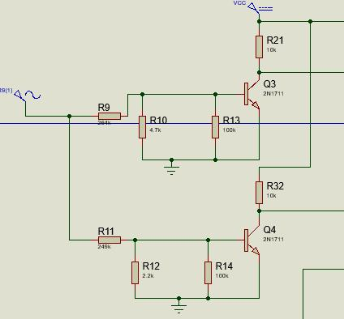
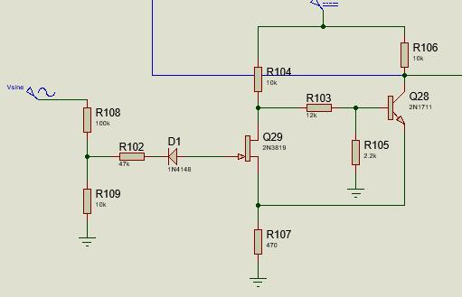
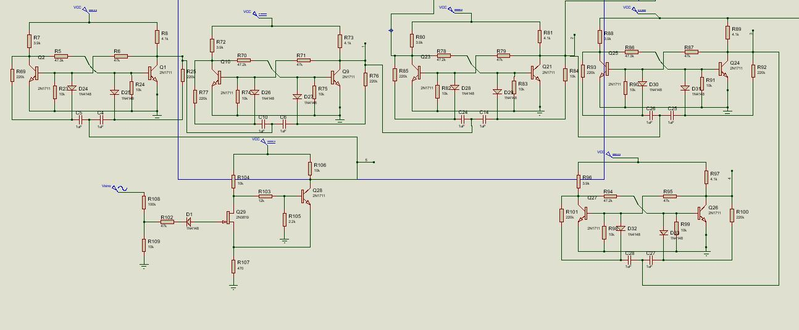
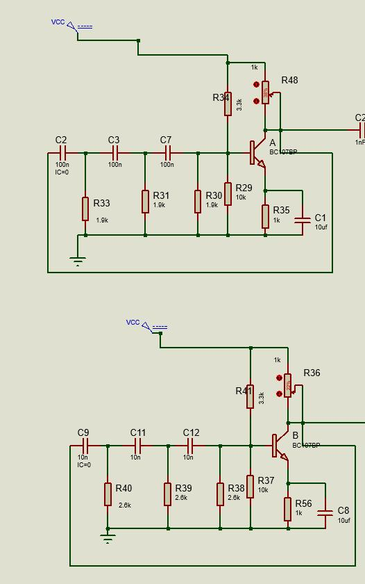
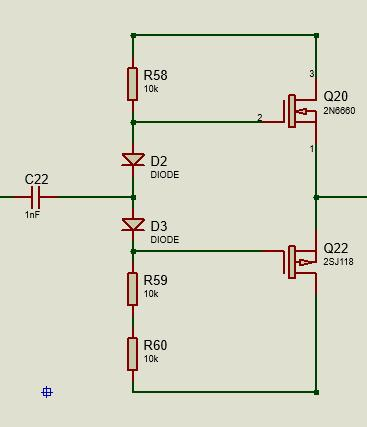
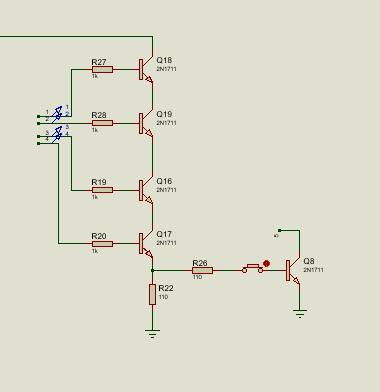

# Discrete Audio Control System

An automatic audio sequencer built **without any integrated circuits**. It watches the amplitude and cycle count of a high-voltage AC input and uses only discrete transistors, diodes, resistors and capacitors to switch two audio oscillators on and off. After 30 input cycles it shuts everything down. Designed and simulated in Proteus, with the schematic and PCB layout in Altium.

## What it does

| Input condition | Result |
|---|---|
| Input amplitude passes 40 V and 80 V | Threshold stages switch (voltage-divider sensing) |
| Counter below 4 (counts 0 to 3) | Speaker 1 plays, a 330 Hz tone |
| Counter 4 and above | Speaker 2 takes over, a 2.5 kHz tone |
| Counter reaches 30 (binary 11110) | Master kill latch stops the clock and everything shuts down |

## Block diagram

The input signal flows through these blocks:

1. **Magnitude sensing:** two resistor dividers set the base bias of a transistor each, so it saturates at about 40 V and 80 V.
2. **Clock conditioning:** a half-wave rectifier (D1) and a transistor Schmitt trigger, whose shared emitter resistor adds hysteresis, turn the input into clean pulses so a noisy cycle is never counted twice.
3. **5-bit ripple counter:** cross-coupled transistor flip-flops, each dividing the previous stage by two, with capacitor-diode steering between stages.
4. **Gating matrix:** transistor stacks give AND logic. Audio passes only when both the voltage and the count conditions are met.
5. **Two RC phase-shift oscillators:** a three-stage RC ladder gives the 180° phase shift for sustained oscillation (Barkhausen criterion).
6. **Output buffers:** isolate the oscillators from the 8 Ω speakers.
7. **Master kill latch:** a 4-transistor series stack watches stages 2 to 5 (HIGH) and stage 1 (LOW), which is binary 30, and saturates a kill transistor that grounds the master clock.

| Magnitude sensing | Schmitt trigger |
|---|---|
|  |  |



| RC oscillators | Output buffer | Kill latch |
|---|---|---|
|  |  |  |

## Design calculations

**Thresholds.** With the divider R9 (249 kΩ) and R10 (4.7 kΩ) and a 0.7 V base-emitter drop, Q3 turns on at about 0.7 × (249 + 4.7) / 4.7 ≈ 38 V. With R11 (249 kΩ) and R12 (2.2 kΩ), Q4 turns on at about 80 V.

**Oscillator frequency.** For a three-stage RC ladder, f = 1 / (15.39 × R × C), with R = 2.2 kΩ:

| Oscillator | Target | Calculated C | Used |
|---|---|---|---|
| Low-mid | 330 Hz | 89 nF | 100 nF |
| Upper-mid | 2.5 kHz | 11.8 nF | 10 nF |

**Counter.** 5 bits, so the maximum count is 31. The stop condition is 30 = 11110₂.

## Files

```
proteus/audio-generator.pdsprj   main Proteus simulation (open in Proteus 8.17 or newer)
proteus/prototypes/              earlier test circuits (an LED circuit built from discrete
                                 transistors, and a version using an IC)
docs/                            schematic excerpts of each block
```

## Tech

Proteus VSM, Altium Designer, discrete BJTs (2N1711, BC107 and others), 1N4148 diodes.
